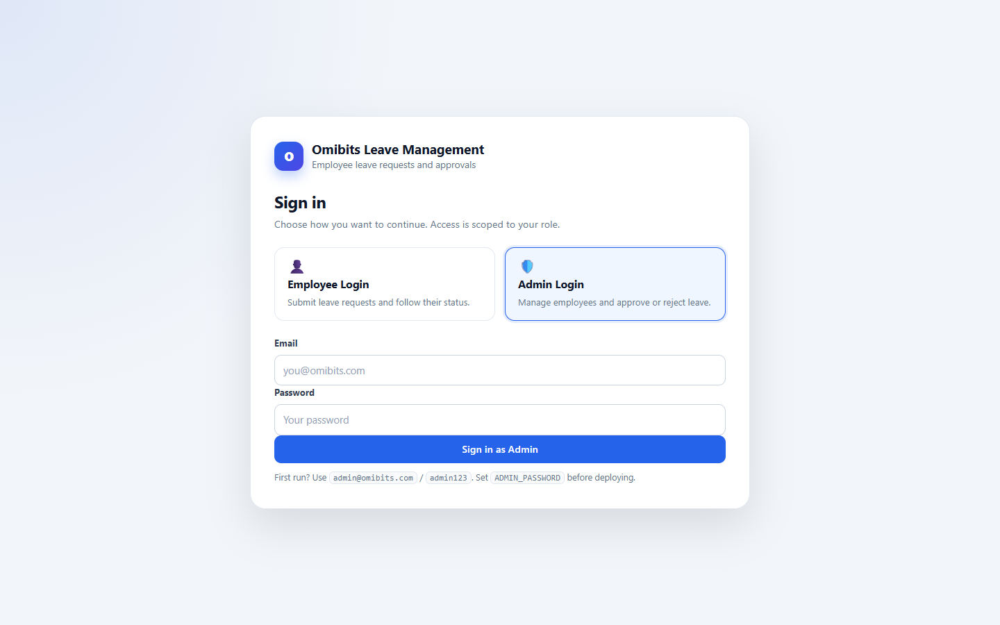
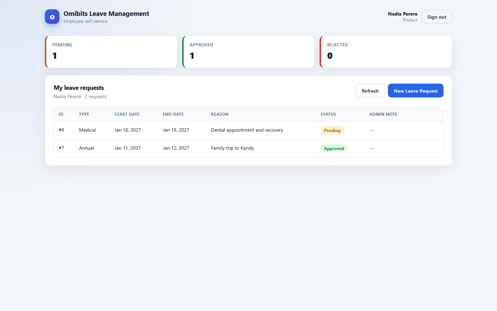
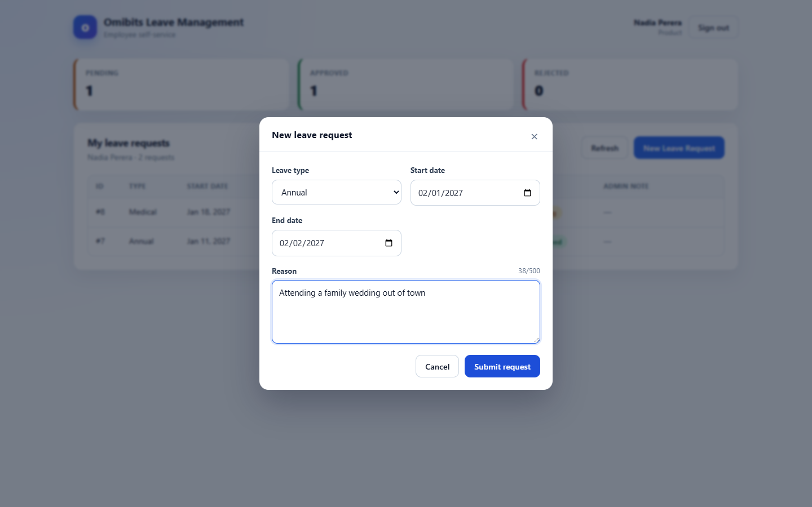
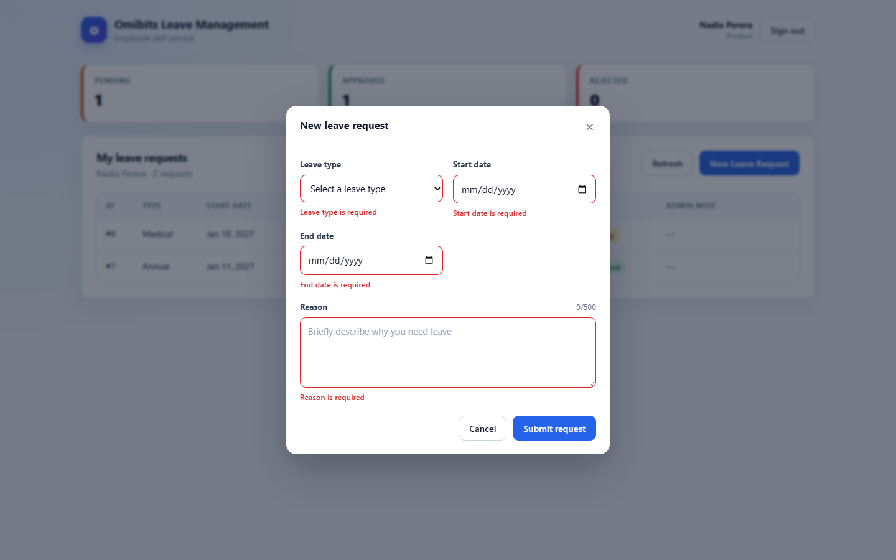
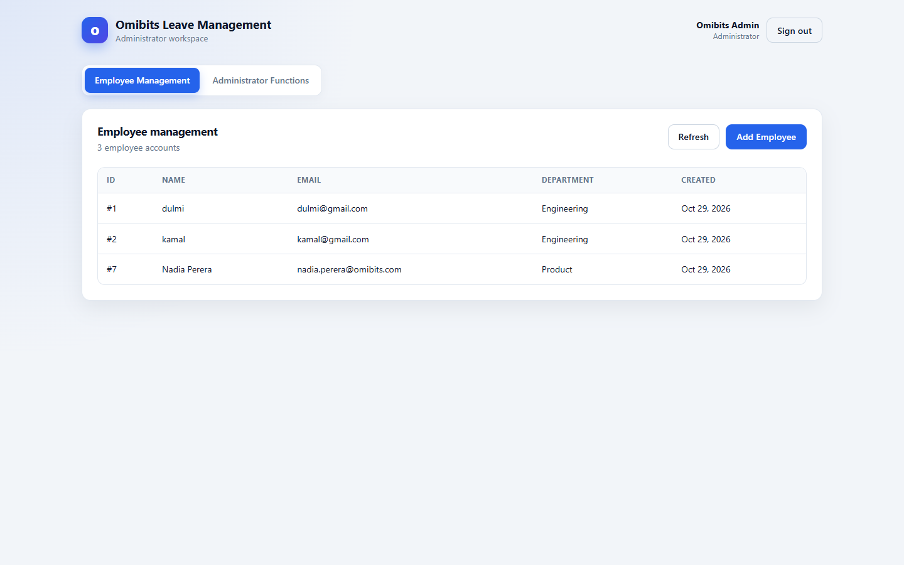
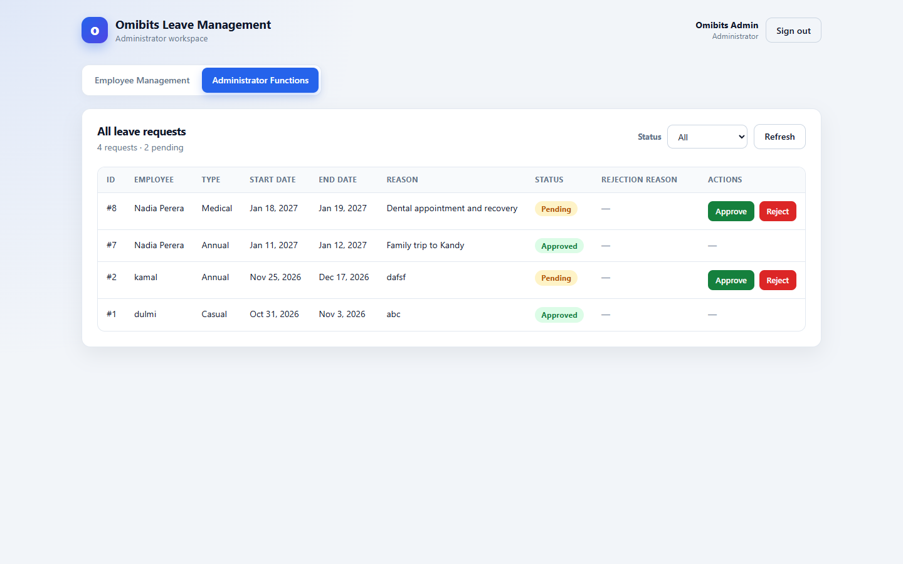
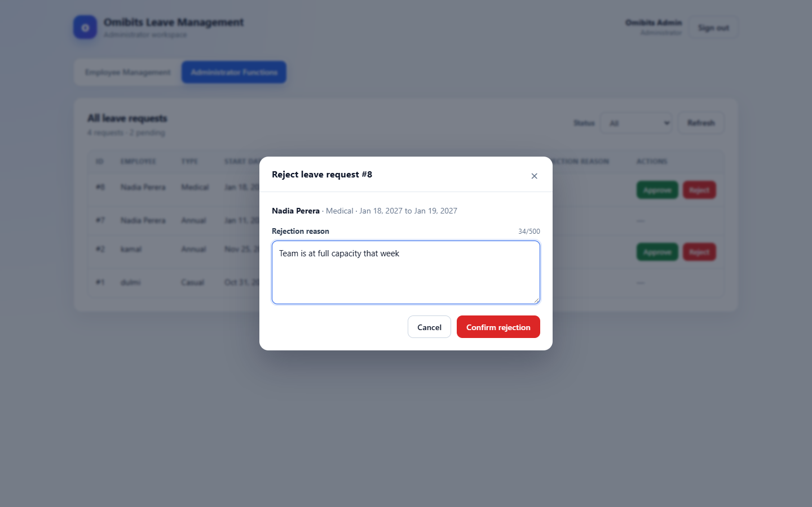

# Omibits — Employee Leave Management System

A small full-stack application for managing employees and their leave requests. Employees sign in to submit leave, administrators manage employee accounts and approve or reject requests, and everyone only sees what their role allows.

> ## Security notice
> Authentication **is** implemented: passwords are stored as salted PBKDF2 hashes and every API call except login requires a bearer token. Role checks are enforced by the backend, not just by hiding buttons.
>
> Two things are still deliberately simple for this exercise: tokens live in server memory (a restart signs everyone out, and the app assumes a single instance), and there is no password-change or password-reset flow. **Set `ADMIN_PASSWORD` before deploying**; the default `admin123` is only for first-run evaluation.

---

## 1. Overview

The system covers three signed-in flows:

1. **Employee self-service** — sign in with an account created by an administrator, see your own requests, and submit a new one with a leave type, start date, end date and reason. New requests start as `PENDING`.
2. **Employee management (admin)** — add an employee and their login account in one step (name, email, department, initial password), then browse the directory.
3. **Administrator functions (admin)** — see every request, approve or reject pending ones. Rejection requires a written reason. Decided requests cannot be changed again.

Business rules are enforced by the backend, not by the UI:

| Rule | Result |
|---|---|
| Duplicate employee email | `409 Conflict` |
| `endDate` before `startDate` | `400 Bad Request` |
| Unknown employee id | `404 Not Found` |
| Unknown leave type | `400 Bad Request` |
| Overlapping pending/approved leave for the same employee | `409 Conflict` |
| Approve/reject a request that is not `PENDING` | `409 Conflict` |
| Reject with a blank reason | `400 Bad Request` |
| Missing/expired session token | `401 Unauthorized` |
| Employee calling an admin-only endpoint | `403 Forbidden` |

---

## 2. Roles and access

| Capability | Employee | Administrator |
|---|---|---|
| Sign in | yes (`Employee Login`) | yes (`Admin Login`) |
| See own leave requests | yes | yes (they also see all requests) |
| Submit leave for self | yes | yes (may target an employee via the API) |
| List the employee directory | no | yes |
| Create employee accounts | no | yes |
| Approve / reject any request | no | yes |

The two login buttons are not cosmetic: the frontend sends the chosen role, and the backend rejects a mismatch with `403` (for example, using the Admin button for an employee account).

### Default administrator

On first start the backend seeds one administrator so a fresh database is usable immediately:

| Field | Default | Override |
|---|---|---|
| Email | `admin@omibits.com` | `ADMIN_EMAIL` |
| Password | `admin123` | `ADMIN_PASSWORD` |
| Name | `Omibits Admin` | `ADMIN_NAME` |

Seeding is skipped when an account with that email already exists. The administrator's employee record is hidden from `GET /api/employees`, so the directory only lists people the administrator manages.

---

## 3. Tech stack and why

| Layer | Choice | Why |
|---|---|---|
| Backend | Java 21 + Spring Boot 4.1 | Batteries-included REST stack; Bean Validation, JPA and a consistent exception layer come for free. |
| Persistence | Spring Data JPA / Hibernate 7 + MySQL 8 | Relational data with a real foreign key between employees and leave requests; MySQL is what the assignment targets. |
| Schema | `schema.sql` + `ddl-auto=validate` | The SQL file is the single readable source of truth; Hibernate only verifies that the entities match it, so the two can never silently drift. |
| Authentication | PBKDF2-HMAC-SHA256 + opaque bearer tokens | Avoids pulling in Spring Security for two roles. Passwords are salted and hashed; sessions are random 256-bit tokens with a 12-hour TTL. |
| Validation | Jakarta Bean Validation + service-layer checks | DTO annotations catch malformed input; the service layer enforces the rules that need database access (existence, overlap, status). |
| Tests | JUnit 5, Mockito, MockMvc, H2 | Fast unit tests for the service layer plus HTTP-level integration tests against an in-memory database. |
| Frontend | React 19 + Vite 8 | Minimal, fast dev server; no state-management library is needed for this screen count. |
| Styling | Plain CSS | Keeps the diff small and avoids a UI framework the reviewer has to learn. |

---

## 4. Prerequisites

| Tool | Version used | Notes |
|---|---|---|
| JDK | 21+ (tested with 25) | `java -version` |
| Maven | 3.9+ | Not required — the repo ships `backend/mvnw` / `backend/mvnw.cmd`. |
| Node.js | 20+ | `node -v`, `npm -v` |
| MySQL | 8.0+ | Must be running on `localhost:3306`. |
| Git | any recent | |

---

## 5. Database setup

The application connects to MySQL with credentials supplied by environment variables.

| Variable | Default | Required |
|---|---|---|
| `DB_USERNAME` | `root` | no |
| `DB_PASSWORD` | *(none)* | **yes** |
| `DB_URL` | `jdbc:mysql://localhost:3306/leave_management?createDatabaseIfNotExist=true` | no |

### 5.1 Create the database

You do **not** have to create it manually — `createDatabaseIfNotExist=true` in the default URL creates `leave_management` on the first connection, provided the MySQL user is allowed to create schemas. To create it yourself:

```sql
CREATE DATABASE leave_management CHARACTER SET utf8mb4 COLLATE utf8mb4_unicode_ci;
```

### 5.2 Create the tables

`backend/src/main/resources/schema.sql` contains the full schema: `employees`, `leave_requests` and `accounts`, with unique constraints, a foreign key and check constraints. It is applied automatically on every application start (`spring.sql.init.mode=always`); every statement uses `CREATE TABLE IF NOT EXISTS`, so restarts are safe and existing MySQL data is never dropped. Hibernate runs in `validate` mode and refuses to start if the entities and the SQL file disagree.

The same file can be applied by hand:

```bash
mysql -u root -p leave_management < backend/src/main/resources/schema.sql
```

### 5.3 Provide the credentials

**Option A — environment variables (recommended):**

```powershell
# PowerShell
$env:DB_PASSWORD = "your-mysql-password"
```

```bash
# bash / zsh
export DB_PASSWORD="your-mysql-password"
```

**Option B — a local `.env` file:** copy `.env.example` to `.env` (repo root or `backend/`) and fill in the values. `.env` is git-ignored. Real credentials must never be committed.

---

## 6. Run the backend

```bash
cd backend
./mvnw spring-boot:run         # Windows: mvnw.cmd spring-boot:run
```

The API is served on **http://localhost:8080**. A successful start ends with:

```
Tomcat started on port 8080 (http)
Started LeaveManagementApplication in 5.4 seconds
```

Quick check — protected endpoints reject anonymous callers:

```bash
curl -i http://localhost:8080/api/leaves
# HTTP/1.1 401
# {"status":401,"error":"Unauthorized","message":"Please sign in to continue"}
```

Sign in and call the same endpoint with the returned token:

```bash
curl -s -X POST http://localhost:8080/api/auth/login \
  -H "Content-Type: application/json" \
  -d '{"email":"admin@omibits.com","password":"admin123","role":"ADMIN"}'

curl -s http://localhost:8080/api/leaves \
  -H "Authorization: Bearer <token>"
```

If Hibernate reports a schema validation error, the database still contains an older version of the tables — apply `schema.sql` manually (section 5.2). Do not drop a database that holds data you care about.

---

## 7. Run the frontend

```bash
cd frontend
npm install
npm run dev
```

Open **http://localhost:5173**. The backend must be running on port 8080.

`VITE_API_BASE_URL` is optional: when it is not set the client falls back to `http://localhost:8080` (`frontend/src/api/client.js`). To point at another host, copy `frontend/.env.example` to `frontend/.env` and change the value.

The session (token + profile) is kept in `localStorage` under `omibits.session`. Any `401` clears it and returns the user to the login screen.

---

## 8. Run the tests

```bash
cd backend
./mvnw test                    # Windows: mvnw.cmd test
```

**54 tests, 0 failures, 0 errors, 0 skipped.**

| Suite | Tests | Kind |
|---|---|---|
| `LeaveRequestServiceTest` | 16 | Unit — Mockito |
| `EmployeeServiceTest` | 3 | Unit — Mockito |
| `LeaveRequestControllerTest` | 7 | Integration — `@SpringBootTest` + MockMvc + H2 |
| `AdminApprovalControllerTest` | 7 | Integration — approval/rejection HTTP contract |
| `EmployeeControllerTest` | 5 | Integration — employee HTTP contract |
| `DataIntegrityViolationHandlerTest` | 1 | Handler — unique-constraint race → 409 |
| `LeaveManagementApplicationTests` | 1 | Context load |
| `AuthFlowTest` | 11 | Integration — login, tokens, role checks, ownership |
| `PasswordHasherTest` | 3 | Unit — hashing and verification |

Integration tests run against an in-memory H2 database (`backend/src/test/resources/application-test.properties`); no MySQL instance is needed to run the suite. Controller tests run with `app.auth.enabled=false` so they can focus on validation and response shapes; `AuthFlowTest` turns enforcement back on and covers the security layer. The frontend has no automated tests; `npm run lint` and `npm run build` are the checks.

---

## 9. API documentation

Base URL: `http://localhost:8080`

Everything under `/api/**` requires `Authorization: Bearer <token>` except `POST /api/auth/login`.

### Endpoints

| Method | Path | Access | Purpose | Success |
|---|---|---|---|---|
| `POST` | `/api/auth/login` | public | Sign in | `200 OK` |
| `GET` | `/api/auth/me` | any session | Current profile | `200 OK` |
| `POST` | `/api/auth/logout` | any session | Invalidate the token | `204 No Content` |
| `POST` | `/api/employees` | admin | Create an employee + account | `201 Created` |
| `GET` | `/api/employees` | admin | List employees (admins hidden) | `200 OK` |
| `POST` | `/api/leaves` | any session | Submit a leave request | `201 Created` |
| `GET` | `/api/leaves` | any session | Admin: all requests. Employee: own requests only | `200 OK` |
| `PATCH` | `/api/leaves/{id}/approve` | admin | Approve a `PENDING` request | `200 OK` |
| `PATCH` | `/api/leaves/{id}/reject` | admin | Reject a `PENDING` request with a reason | `200 OK` |

### Login

```http
POST /api/auth/login
Content-Type: application/json

{ "email": "admin@omibits.com", "password": "admin123", "role": "ADMIN" }
```

```json
200 OK
{
  "token": "K3f...43-char-url-safe-token",
  "employeeId": 3,
  "name": "Omibits Admin",
  "email": "admin@omibits.com",
  "department": "Administration",
  "role": "ADMIN"
}
```

`role` is optional, but when present the account must hold it. A wrong password returns `401`; a valid account used with the wrong button returns `403`.

### Create employee

```http
POST /api/employees
Authorization: Bearer <admin-token>
Content-Type: application/json

{
  "name": "Jane Doe",
  "email": "jane.doe@omibits.com",
  "department": "Engineering",
  "password": "initial-password"
}
```

```json
201 Created
{
  "id": 1,
  "name": "Jane Doe",
  "email": "jane.doe@omibits.com",
  "department": "Engineering",
  "createdAt": "2026-10-28T10:12:31.442"
}
```

The employee record and its `accounts` row are created in one transaction: an employee without credentials could never sign in. The password must be 8–72 characters and is only ever stored as a PBKDF2 hash. Email is trimmed and lowercased, so duplicates are detected case-insensitively.

### List employees

```http
GET /api/employees
Authorization: Bearer <admin-token>
```

```json
200 OK
[
  { "id": 1, "name": "Jane Doe", "email": "jane.doe@omibits.com", "department": "Engineering", "createdAt": "2026-10-28T10:12:31.442" }
]
```

### Submit a leave request

```http
POST /api/leaves
Authorization: Bearer <employee-token>
Content-Type: application/json

{
  "leaveType": "ANNUAL",
  "startDate": "2026-11-02",
  "endDate": "2026-11-04",
  "reason": "Family trip"
}
```

```json
201 Created
{
  "id": 1,
  "employeeId": 1,
  "employeeName": "Jane Doe",
  "leaveType": "ANNUAL",
  "startDate": "2026-11-02",
  "endDate": "2026-11-04",
  "reason": "Family trip",
  "status": "PENDING",
  "rejectionReason": null,
  "createdAt": "2026-10-28T10:14:02.118",
  "updatedAt": "2026-10-28T10:14:02.118"
}
```

Employee sessions always submit for themselves — an `employeeId` in the body is overwritten with the signed-in employee's id, so one employee cannot file leave under another's name. Administrators may supply `employeeId` explicitly.

### List leave requests

```http
GET /api/leaves
Authorization: Bearer <token>
```

Administrators receive every request; employees receive only their own. Both are ordered by `createdAt` descending.

### Approve

```http
PATCH /api/leaves/1/approve
Authorization: Bearer <admin-token>
```

```json
200 OK
{ "id": 1, "status": "APPROVED", "rejectionReason": null, "...": "remaining fields as above" }
```

### Reject

```http
PATCH /api/leaves/2/reject
Authorization: Bearer <admin-token>
Content-Type: application/json

{ "rejectionReason": "Team is at full capacity that week" }
```

```json
200 OK
{ "id": 2, "status": "REJECTED", "rejectionReason": "Team is at full capacity that week", "...": "remaining fields as above" }
```

### Error format

Every error uses the same envelope, produced by `GlobalExceptionHandler` (`@RestControllerAdvice`):

```json
{
  "timestamp": "2026-10-28T10:15:42.991",
  "status": 400,
  "error": "Validation Failed",
  "message": "Validation failed for request",
  "fieldErrors": { "email": "Email should be valid" }
}
```

`fieldErrors` is `null` when the error is not field-specific (for example a `409`).

### Status codes

| Code | When |
|---|---|
| `200` | Successful read, login, approve or reject |
| `201` | Employee or leave request created |
| `204` | Logout |
| `400` | Bean Validation failure, malformed JSON, unknown leave type, `endDate < startDate`, blank rejection reason |
| `401` | Missing, invalid or expired token; wrong email/password |
| `403` | Authenticated but not allowed (employee calling admin endpoints, wrong login button) |
| `404` | Employee or leave request id does not exist |
| `409` | Duplicate email, invalid status transition, overlapping leave |
| `500` | Unexpected server error (details are not leaked to the client) |

CORS is enabled for `http://localhost:5173` only (`backend/src/main/java/com/example/leave/config/WebConfig.java`).

---

## 10. Screenshots

The screenshots live in [`docs/screenshots/`](docs/screenshots) and are captured from the running application at 1440×900, using a temporary demo dataset that was removed afterwards.

### Login

Two explicit buttons — **Employee Login** and **Admin Login** — each with its own form.



### Employee dashboard

Summary cards, the signed-in employee's own requests, and the **New Leave Request** action.



### New leave request

Leave type, start date, end date and reason, with a character count and required-field marking.



### Validation errors

Required fields are validated in the browser first; the same rules are re-checked by the API.



### Employee management

The **Add Employee** modal creates the employee and their login account; the directory lists everyone.



### Administrator functions

Every request with status badges and row actions; only pending rows offer Approve/Reject.



### Approve / reject

Rejection opens a modal and cannot be confirmed without a reason.



---

## 11. Design decisions

**The database owns the schema.** `schema.sql` is the source of truth and is applied on startup; Hibernate runs in `validate` mode. The alternative — `ddl-auto=update` — hides schema changes and makes the checked-in SQL file decorative. Validation mode means a schema mismatch fails loudly instead of at runtime.

**Strict layering.** `controller → service → repository`, with `entity`, `dto`, `exception`, `security` and `config` as supporting packages. Controllers only bind, delegate and choose a status code; no controller contains a business rule.

**DTOs at the boundary, never entities.** Requests and responses are separate classes (`EmployeeRequest`/`EmployeeResponse`, `LeaveRequestCreateRequest`/`LeaveRequestResponse`, `LoginRequest`/`LoginResponse`, `RejectLeaveRequest`). This keeps lazy JPA associations out of JSON serialization, prevents clients from setting `id`/`status`/`createdAt`/`role`, and lets validation live on the input shape.

**Credentials live in a separate `accounts` table.** Adding password columns to `employees` would have required a destructive `ALTER TABLE` for existing data. A one-to-one `accounts` row (unique `employee_id`, unique `email`, hashed password, role) also expresses the model honestly: an employee record can exist without a login. The table is created with `CREATE TABLE IF NOT EXISTS`, so an existing database is upgraded in place.

**Authentication without Spring Security.** For two roles and one token type, a small explicit layer is easier to review: PBKDF2-HMAC-SHA256 with 120,000 iterations and a per-password 16-byte salt (`PasswordHasher`), random 256-bit bearer tokens held in a `ConcurrentHashMap` with a 12-hour TTL (`AuthService`), and one `HandlerInterceptor` that guards `/api/**`. Endpoints opt out with `@PublicEndpoint`; administrator-only handlers are marked `@AdminOnly`. A `401`/`403` is written as JSON by the interceptor, so it matches the normal error envelope closely enough for the single client parser.

**Authorisation is enforced server-side, twice where it matters.** The interceptor rejects employees from admin endpoints, and the controller/service layer scopes reads: an employee's `GET /api/leaves` queries by their own id, and `POST /api/leaves` overwrites any supplied `employeeId` with the session's employee. Hiding a button in React is never the only defence.

**Validation split by what it needs.** Format/required rules are Bean Validation annotations on the DTOs. Rules that need the database (employee exists, overlapping leave) or that compare two fields (`endDate` vs `startDate`) live in `LeaveRequestService`, so they hold even when the API is called directly with `curl`. `employeeId` is intentionally **not** `@NotNull` on the leave DTO, because employee submissions do not send it — the controller fills it from the session before the service validates it.

**Status transitions are explicit.** The only legal transitions are `PENDING → APPROVED` and `PENDING → REJECTED`; anything else throws `InvalidStatusTransitionException` → `409`. Rejection requires a non-blank reason at both the DTO and the service layer, and the reason is trimmed before it is stored.

**Overlap check spans pending and approved leave only.** `LeaveRequestRepository.existsOverlap` uses the standard range intersection `existing.start <= new.end AND existing.end >= new.start`, filtered to `PENDING` and `APPROVED`. A `REJECTED` request therefore does not block a resubmission. It is enforced inside the create transaction.

**Errors have one shape.** `ErrorResponse` always carries `timestamp`, `status`, `error`, `message` and `fieldErrors`, so the client has exactly one parsing path (`frontend/src/api/client.js`).

**The unique constraint is the last line of defence.** The service pre-checks the email for a friendly `409`, and the database `UNIQUE` constraint catches the check-then-insert race; `DataIntegrityViolationException` is mapped to `409` as well.

---

## 12. Challenges

**Making `schema.sql` real.** The first version used `spring.jpa.hibernate.ddl-auto=update`, which built the tables at runtime and left `schema.sql` as decoration. Switching to `spring.sql.init.mode=always` + `ddl-auto=validate` surfaced two problems: MySQL must already know the database (hence `createDatabaseIfNotExist=true` in the URL), and Hibernate validates column types, not just names, so `schema.sql` had to match the entity mappings exactly. The H2 test profile keeps `spring.sql.init.mode=never` because `schema.sql` is MySQL-specific; Hibernate creates the H2 schema from the entities instead.

**Adding authentication without destroying data.** The straightforward `ALTER TABLE employees ADD password …` would have forced a migration on an existing database. A separate `accounts` table created with `CREATE TABLE IF NOT EXISTS` upgrades the schema in place, keeps old employees intact, and leaves the door open to accounts being added later. Employees created before authentication existed simply have no account and cannot sign in.

**Validation ran before the controller could fill in `employeeId`.** Employee submissions intentionally omit `employeeId` (it comes from the token), but `@NotNull` on the DTO made the request fail with `400` before the controller's session override ran. Moving the required check into `LeaveRequestService` — after the controller sets the id — fixed it without weakening the rule, and a focused handler maps the remaining "no employee id" case to `400`.

**Old controller tests assumed an open API.** The existing suites exercise validation and response shapes without tokens. Rather than rewrite all of them, the test profile sets `app.auth.enabled=false`; a new `AuthFlowTest` runs with enforcement on and covers login, role mismatch, ownership scoping, admin-only approvals, employee creation + first login, and logout invalidation.

**Invalid enum values bypass Bean Validation.** Sending `"leaveType": "SICK"` fails during Jackson deserialization, before any `@NotNull` runs, so the response was a generic "Malformed or unreadable request body". `GlobalExceptionHandler` now inspects `HttpMessageNotReadableException`, recognises the `LeaveType` failure and returns `400` with the list of allowed values — while still returning the generic message for genuinely broken JSON.

**Spring Boot 4 ships Jackson 3.** The familiar `com.fasterxml.jackson.databind.ObjectMapper` import no longer applies to the test harness; the controller tests use `tools.jackson.databind.ObjectMapper`. This was a compile-time surprise rather than a runtime bug.

---

## 13. Limitations

- **Sessions are in memory.** Restarting the backend signs everyone out, and a second instance would not share tokens. A production deployment should move sessions to a shared store or switch to signed tokens.
- **No password change or reset.** The seeded administrator password can only be changed by setting `ADMIN_PASSWORD` before the first start (or by removing the account row and letting the seeder recreate it). This is the main follow-up security task.
- **Tokens are sent in `localStorage` and over plain HTTP** in development. Use HTTPS and a hardened storage strategy in production.
- No past-date rule: a leave request may start in the past.
- No leave balance or allowance tracking; overlapping is the only quota-like check.
- No pagination, sorting or filtering on the server; `GET /api/leaves` returns everything (the admin UI filters by status client-side).
- Employees cannot be edited or deleted, and leave requests cannot be cancelled.
- Pre-existing employees without an `accounts` row cannot sign in; the UI has no "create account for existing employee" flow.
- No optimistic locking: two administrators acting on the same request at the same instant both pass the `PENDING` check, and the last write wins.
- CORS is pinned to `http://localhost:5173`.
- No rate limiting, audit trail or structured logging.

---

## 14. Improvements with one more day

1. **Password lifecycle** — change-password and admin-triggered reset, with a forced reset on first login.
2. **Persistent sessions** — a `sessions` table or signed JWT so restarts and multiple instances behave.
3. **Past-date rule** — reject `startDate < today` in `LeaveRequestService` (> 400) and mirror it with `min` on the date inputs.
4. **Leave balance** — an annual allowance per employee and a check that the requested days fit the remaining balance.
5. **Pagination** — `Pageable` on `GET /api/leaves` plus a server-side status filter, so the admin table scales.
6. **Docker Compose** — MySQL + backend + frontend with one `docker compose up`, removing the local MySQL prerequisite.
7. **Swagger / OpenAPI** — springdoc to publish the contract and replace the hand-written API tables.

---

## 15. Incomplete requirements

Being explicit about what is *not* done:

- **Past-date blocking is not implemented** (it was optional in the brief).
- **Password change/reset is not implemented** — see the security notice and limitations.
- **Schema strategy:** `schema.sql` is the source of truth and Hibernate validates against it, rather than Hibernate generating the schema. The H2 test profile intentionally skips `schema.sql` and lets Hibernate create the in-memory schema from the entities.
- **No delete/update endpoints** for employees or leave requests, because the brief only asked for create/list plus approve/reject.
- The frontend has no automated tests; backend coverage is 54 tests, and `npm run lint` / `npm run build` are the frontend checks.

---

## 16. Verification performed

- `./mvnw test` — **54 tests, 0 failures, 0 errors, 0 skipped**.
- `npm run lint` — clean; `npm run build` — production bundle built.
- Full flow exercised against the running app (real MySQL) through both the API and the browser: admin login → create employee → employee login → submit leave → admin approve and reject (rejection reason required) → employee sees the updated statuses.
- Anonymous `GET /api/leaves` returns `401`; an employee calling admin endpoints gets `403`; logging out invalidates the token.

---

## 17. AI usage / attribution

An AI coding assistant (opencode) was used during this exercise to scaffold parts of the Spring Boot backend, implement the authentication layer, draft the test suite, and help write this README. Every file was reviewed afterwards, and the code is understood and explainable line by line — including why validation is split between DTO annotations and the service layer, why credentials live in a separate `accounts` table, how the bearer-token interceptor enforces roles, and how the overlap query and status transitions work.

Third-party libraries are used under their respective open-source licences (Spring Boot, React, Vite); no other code was copied from external sources.
